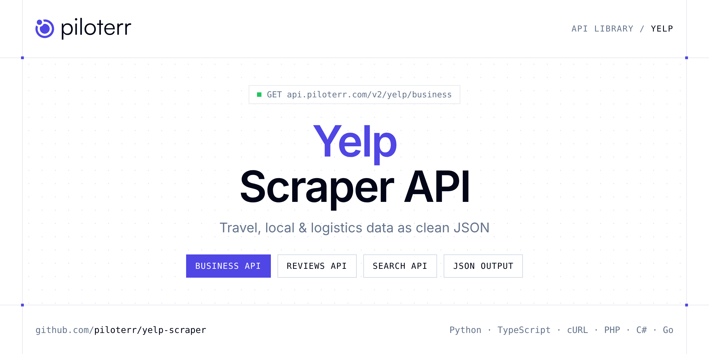

<p align="center">
  <a href="https://www.piloterr.com"></a>
</p>

# Yelp Scraper API

[](https://discord.gg/CFj3ph8aHU) [](https://app.piloterr.com) [](https://app.piloterr.com/openapi) [](LICENSE)

The **Piloterr Yelp Scraper API** lets you extract public data from Yelp as **clean, structured JSON** — no proxies, headless browsers or HTML parsing to maintain. Endpoints available in production:

- **Yelp Business API** — Fetch a Yelp business profile from a full business URL with phone, address, website, logo, hours, and claim status.
- **Yelp Reviews API** — Fetch paginated Yelp reviews for a business with rating, text, author profile, reactions, and attached photos or videos.
- **Yelp Search API** — Search Yelp by keyword and location and retrieve paginated business cards with ratings, categories, photos, and sponsored flags.

Use it for price tracking, review and reputation monitoring, local market research or logistics tracking.

| Endpoint | Path | Credits | What you get |
|---|---|---|---|
| [Yelp Business API](#yelp-business-api) | `/v2/yelp/business` | 2 | Fetch a Yelp business profile from a full business URL with phone, address, website, logo, hours, and claim status. |
| [Yelp Reviews API](#yelp-reviews-api) | `/v2/yelp/reviews` | 2 | Fetch paginated Yelp reviews for a business with rating, text, author profile, reactions, and attached photos or videos. |
| [Yelp Search API](#yelp-search-api) | `/v2/yelp/search` | 2 | Search Yelp by keyword and location and retrieve paginated business cards with ratings, categories, photos, and sponsored flags. |

## Table of contents

- [How it works](#how-it-works)
- [Yelp Business API](#yelp-business-api)
- [Yelp Reviews API](#yelp-reviews-api)
- [Yelp Search API](#yelp-search-api)
- [Code examples in other languages](#code-examples-in-other-languages)
- [Practical use cases](#practical-use-cases)
- [Why Piloterr?](#why-piloterr)
- [FAQ](#faq)
- [Official SDKs](#official-sdks)
- [Related scrapers](#related-scrapers)
- [Support](#support)

## How it works

1. **Create a free Piloterr account** and copy your API key from the [dashboard](https://app.piloterr.com).
2. **Send a `GET` (or `POST`) request** to `https://api.piloterr.com/v2/...` with the header `x-api-key: YOUR_API_KEY`.
3. **Receive structured JSON** — Piloterr handles rendering, proxies, retries and parsing.

```bash
export PILOTERR_API_KEY="your-api-key"
pip install requests        # Python
# TypeScript: Node.js 18+ (native fetch), run with `npx tsx file.ts`
```

> Every endpoint accepts both `GET` (query string) and `POST` (JSON body with the same fields).

## Yelp Business API

Fetch a Yelp business profile from a full business URL with phone, address, website, logo, hours, and claim status.

`GET | POST https://api.piloterr.com/v2/yelp/business` · **2 credits per request** · [Full reference](https://app.piloterr.com/openapi)

### Request parameters

| Parameter | Type | Required | Description |
|---|---|---|---|
| `query` | string | ✅ | Full Yelp business URL. |

### Python example

```python
import json
import os
import requests

response = requests.get(
    "https://api.piloterr.com/v2/yelp/business",
    headers={"x-api-key": os.environ["PILOTERR_API_KEY"]},
    params={
        "query": "https://www.yelp.com/biz/novela-san-francisco-2",
    },
    timeout=120,
)
response.raise_for_status()
data = response.json()

print(json.dumps(data, indent=2, ensure_ascii=False)[:2000])
```

### TypeScript example

```typescript
type YelpBusiness = {
  url?: string;
  logo?: string;
  name?: string;
  phone?: string;
  address?: string;
  website?: string;
  open_hours?: {
    fri?: string;
    mon?: string;
    sat?: string;
    sun?: string;
    thu?: string;
    tue?: string;
    wed?: string;
  };
  business_id?: string;
  claim_status?: string;
};

const params = new URLSearchParams({
  "query": "https://www.yelp.com/biz/novela-san-francisco-2",
});

const response = await fetch(`https://api.piloterr.com/v2/yelp/business?${params}`, {
  headers: { "x-api-key": process.env.PILOTERR_API_KEY! },
});
if (!response.ok) throw new Error(`Piloterr error ${response.status}: ${await response.text()}`);

const data = (await response.json()) as YelpBusiness;

console.log(JSON.stringify(data, null, 2).slice(0, 2000));
```

<details>
<summary><b>POST variant</b></summary>

```http
POST https://api.piloterr.com/v2/yelp/business
x-api-key: YOUR_API_KEY
Content-Type: application/json

{"query": "https://www.yelp.com/biz/novela-san-francisco-2"}
```
</details>

### Output example

Example response from the API reference, abridged — real values depend on the page you scrape.

```json
{
  "url": "https://www.yelp.com/biz/novela-san-francisco-2?osq=bars+open&rr=4",
  "logo": "https://s3-media0.fl.yelpcdn.com/businessregularlogo/dkB_F32_r_PfLpQLAuNsFA/ms.jpg",
  "name": "Novela",
  "phone": "example",
  "address": "662 Mission St San Francisco, CA 94105",
  "website": "novelasf.com",
  "open_hours": {
    "fri": "4:00 PM - 2:00 AM (Next day)",
    "mon": "4:00 PM - 12:00 AM (Next day)",
    "sat": "5:00 PM - 2:00 AM (Next day)",
    "sun": "Closed",
    "thu": "4:00 PM - 2:00 AM (Next day)",
    "tue": "4:00 PM - 1:00 AM (Next day)",
    "wed": "4:00 PM - 1:00 AM (Next day)"
  },
  "business_id": "cX5dOMkwZ5rqWbeIJpw_Ig",
  "claim_status": "claimed"
}
```

### Response fields

| Field | Type | Description |
|---|---|---|
| `url` | string |  |
| `logo` | string |  |
| `name` | string |  |
| `phone` | string |  |
| `address` | string |  |
| `website` | string |  |
| `open_hours` | object |  |
| `open_hours.fri` | string |  |
| `open_hours.mon` | string |  |
| `open_hours.sat` | string |  |
| `open_hours.sun` | string |  |
| `open_hours.thu` | string |  |
| `open_hours.tue` | string |  |
| `open_hours.wed` | string |  |
| `business_id` | string |  |
| `claim_status` | string |  |

## Yelp Reviews API

Fetch paginated Yelp reviews for a business with rating, text, author profile, reactions, and attached photos or videos.

`GET | POST https://api.piloterr.com/v2/yelp/reviews` · **2 credits per request** · [Full reference](https://app.piloterr.com/openapi)

### Request parameters

| Parameter | Type | Required | Description |
|---|---|---|---|
| `query` | string | ✅ | Yelp business ID / encid. |
| `page` | number | — | Page number. Each page returns up to 10 reviews. Default: `1`. |

### Python example

```python
import json
import os
import requests

response = requests.get(
    "https://api.piloterr.com/v2/yelp/reviews",
    headers={"x-api-key": os.environ["PILOTERR_API_KEY"]},
    params={
        "query": "cX5dOMkwZ5rqWbeIJpw_Ig",
    },
    timeout=120,
)
response.raise_for_status()
data = response.json()

print(json.dumps(data, indent=2, ensure_ascii=False)[:2000])
```

### TypeScript example

```typescript
type YelpReviews = {
  url?: string;
  results?: {
    text?: {
      full?: string;
      language?: string;
    };
    encid?: string;
    author?: {
      encid?: string;
      display_name?: string;
      friend_count?: number;
      review_count?: number;
      display_location?: string;
      business_photo_count?: number;
    };
    rating?: number;
    business?: {
      name?: string;
      alias?: string;
      encid?: string;
    };
    feedback?: {
      cool_count?: unknown;
      funny_count?: unknown;
      useful_count?: unknown;
    };
    created_at?: unknown;
    business_photos?: unknown[];
    business_videos?: unknown[];
    available_reactions?: {
      count?: number;
      display_text?: string;
      reaction_type?: string;
    }[];
  }[];
  pagination?: {
    next?: number;
    current?: number;
    other_pages?: unknown[];
    total_pages?: number;
    has_next_page?: boolean;
    total_results?: number;
  };
  business_id?: string;
};

const params = new URLSearchParams({
  "query": "cX5dOMkwZ5rqWbeIJpw_Ig",
});

const response = await fetch(`https://api.piloterr.com/v2/yelp/reviews?${params}`, {
  headers: { "x-api-key": process.env.PILOTERR_API_KEY! },
});
if (!response.ok) throw new Error(`Piloterr error ${response.status}: ${await response.text()}`);

const data = (await response.json()) as YelpReviews;

console.log(JSON.stringify(data, null, 2).slice(0, 2000));
```

<details>
<summary><b>POST variant</b></summary>

```http
POST https://api.piloterr.com/v2/yelp/reviews
x-api-key: YOUR_API_KEY
Content-Type: application/json

{"query": "cX5dOMkwZ5rqWbeIJpw_Ig"}
```
</details>

### Output example

Example response from the API reference, abridged — real values depend on the page you scrape.

```json
{
  "url": "https://www.yelp.com/biz_photos/cX5dOMkwZ5rqWbeIJpw_Ig",
  "results": [
    {
      "text": {
        "full": "Superb cocktails and friendly service \nDecor are modern and sleek \nCrabcakes and Turkish chicken legs are delicious",
        "language": "en"
      },
      "encid": "ftgDNwNVnb3xwx8XRP9n9Q",
      "author": {
        "encid": "example",
        "display_name": "example",
        "friend_count": 0,
        "review_count": 0,
        "display_location": "example",
        "business_photo_count": 0
      },
      "rating": 5,
      "business": {
        "name": "Novela",
        "alias": "novela-san-francisco-2",
        "encid": "cX5dOMkwZ5rqWbeIJpw_Ig"
      },
      "feedback": {
        "cool_count": null,
        "funny_count": null,
        "useful_count": null
      },
      "created_at": null,
      "business_photos": [],
      "business_videos": [],
      "available_reactions": [
        {},
        {}
      ]
    },
    {
      "text": {
        "full": "The vibe is amazing. We walked in without a reservation and were seated right away even though they were busy. The host was great and ser…",
        "language": "en"
      },
      "encid": "iZUQegcOX-GIKLacrlBJ2g",
      "author": {
        "encid": "example",
        "display_name": "example",
        "friend_count": 0,
        "review_count": 0,
        "display_location": "example",
        "business_photo_count": 0
      },
      "rating": 4,
      "business": {
        "name": "Novela",
        "alias": "novela-san-francisco-2",
        "encid": "cX5dOMkwZ5rqWbeIJpw_Ig"
      },
      "feedback": {
        "cool_count": null,
        "funny_count": null,
        "useful_count": null
      },
      "created_at": null,
      "business_photos": [
        {}
      ],
      "business_videos": [
        {}
      ],
      "available_reactions": [
        {},
        {}
      ]
    }
  ],
  "pagination": {
    "next": 2,
    "current": 1,
    "other_pages": [],
    "total_pages": 155,
    "has_next_page": true,
    "total_results": 1545
  },
  "business_id": "cX5dOMkwZ5rqWbeIJpw_Ig"
}
```

### Response fields

| Field | Type | Description |
|---|---|---|
| `url` | string |  |
| `results[]` | object[] |  |
| `results[].text` | object |  |
| `results[].encid` | string |  |
| `results[].author` | object |  |
| `results[].rating` | integer |  |
| `results[].business` | object |  |
| `results[].feedback` | object |  |
| `results[].created_at` | object |  |
| `results[].business_photos` | any[] |  |
| `results[].business_videos` | any[] |  |
| `results[].available_reactions[]` | object[] |  |
| `pagination` | object |  |
| `pagination.next` | integer |  |
| `pagination.current` | integer |  |
| `pagination.other_pages` | any[] |  |
| `pagination.total_pages` | integer |  |
| `pagination.has_next_page` | boolean |  |
| `pagination.total_results` | integer |  |
| `business_id` | string |  |

## Yelp Search API

Search Yelp by keyword and location and retrieve paginated business cards with ratings, categories, photos, and sponsored flags.

`GET | POST https://api.piloterr.com/v2/yelp/search` · **2 credits per request** · [Full reference](https://app.piloterr.com/openapi)

### Request parameters

| Parameter | Type | Required | Description |
|---|---|---|---|
| `query` | string | ✅ | Full Yelp search URL with `find_desc` and `find_loc` query parameters. |

### Python example

```python
import json
import os
import requests

response = requests.get(
    "https://api.piloterr.com/v2/yelp/search",
    headers={"x-api-key": os.environ["PILOTERR_API_KEY"]},
    params={
        "query": "https://www.yelp.com/search?find_desc=Cocktail+Bars&find_loc=San+Francisco%2C+CA",
    },
    timeout=120,
)
response.raise_for_status()
data = response.json()

print(json.dumps(data, indent=2, ensure_ascii=False)[:2000])
```

### TypeScript example

```typescript
type YelpSearch = {
  results?: {
    link?: string;
    name?: string;
    alias?: string;
    is_ad?: boolean;
    phone?: string;
    biz_id?: string;
    rating?: number;
    picture?: string;
    categories?: string[];
    price_range?: string;
    review_count?: number;
  }[];
  pagination?: {
    next?: number;
    current?: number;
    other_pages?: number[];
    total_pages?: number;
    has_next_page?: boolean;
    total_results?: number;
  };
};

const params = new URLSearchParams({
  "query": "https://www.yelp.com/search?find_desc=Cocktail+Bars&find_loc=San+Francisco%2C+CA",
});

const response = await fetch(`https://api.piloterr.com/v2/yelp/search?${params}`, {
  headers: { "x-api-key": process.env.PILOTERR_API_KEY! },
});
if (!response.ok) throw new Error(`Piloterr error ${response.status}: ${await response.text()}`);

const data = (await response.json()) as YelpSearch;

console.log(JSON.stringify(data, null, 2).slice(0, 2000));
```

<details>
<summary><b>POST variant</b></summary>

```http
POST https://api.piloterr.com/v2/yelp/search
x-api-key: YOUR_API_KEY
Content-Type: application/json

{"query": "https://www.yelp.com/search?find_desc=Cocktail+Bars&find_loc=San+Francisco%2C+CA"}
```
</details>

### Output example

Example response from the API reference, abridged — real values depend on the page you scrape.

```json
{
  "results": [
    {
      "link": "https://www.yelp.com/adredir?ad_business_id=tGntxs1wgwl2IVcwgfhm0A&campaign_id=219482732&click_origin=search_results&placement=vertical_0…",
      "name": "Catch",
      "alias": "catch-san-francisco-3",
      "is_ad": true,
      "phone": "example",
      "biz_id": "tGntxs1wgwl2IVcwgfhm0A",
      "rating": 4,
      "picture": "https://s3-media0.fl.yelpcdn.com/bphoto/fkCtr1sSfhz1DY4EjIqoBg/ls.jpg",
      "categories": [
        "Cocktail Bars",
        "Breakfast & Brunch"
      ],
      "price_range": "$$$",
      "review_count": 70
    },
    {
      "link": "https://www.yelp.com/adredir?ad_business_id=e36DPs7qLGswtxbIy9XlVQ&campaign_id=214587588&click_origin=search_results&placement=vertical_0…",
      "name": "200 Channels",
      "alias": "200-channels-san-francisco-3",
      "is_ad": true,
      "phone": "example",
      "biz_id": "e36DPs7qLGswtxbIy9XlVQ",
      "rating": 4.8,
      "picture": "https://s3-media0.fl.yelpcdn.com/offerphoto/M9FHUPMUcnH82P-qUYCZLg/ls.jpg",
      "categories": [
        "Cabaret",
        "Speakeasies"
      ],
      "price_range": null,
      "review_count": 5
    }
  ],
  "pagination": {
    "next": 2,
    "current": 1,
    "other_pages": [
      2,
      3
    ],
    "total_pages": 9,
    "has_next_page": true,
    "total_results": 0
  }
}
```

### Response fields

| Field | Type | Description |
|---|---|---|
| `results[]` | object[] |  |
| `results[].link` | string |  |
| `results[].name` | string |  |
| `results[].alias` | string |  |
| `results[].is_ad` | boolean |  |
| `results[].phone` | string |  |
| `results[].biz_id` | string |  |
| `results[].rating` | integer |  |
| `results[].picture` | string |  |
| `results[].categories` | string[] |  |
| `results[].price_range` | string |  |
| `results[].review_count` | integer |  |
| `pagination` | object |  |
| `pagination.next` | integer |  |
| `pagination.current` | integer |  |
| `pagination.other_pages` | integer[] |  |
| `pagination.total_pages` | integer |  |
| `pagination.has_next_page` | boolean |  |
| `pagination.total_results` | integer |  |

## Code examples in other languages

Ready-to-run examples live in the [`examples/`](examples) folder. Each one reads your key from the `PILOTERR_API_KEY` environment variable.

| Language | Business | Reviews | Search |
|---|---|---|---|
| cURL (Bash) | [`business`](examples/curl/business.sh) | [`reviews`](examples/curl/reviews.sh) | [`search`](examples/curl/search.sh) |
| PHP | [`business`](examples/php/business.php) | [`reviews`](examples/php/reviews.php) | [`search`](examples/php/search.php) |
| C# | [`business`](examples/csharp/Business.cs) | [`reviews`](examples/csharp/Reviews.cs) | [`search`](examples/csharp/Search.cs) |
| Go | [`business`](examples/go/business.go) | [`reviews`](examples/go/reviews.go) | [`search`](examples/go/search.go) |
| Java | [`business`](examples/java/BusinessExample.java) | [`reviews`](examples/java/ReviewsExample.java) | [`search`](examples/java/SearchExample.java) |
| Ruby | [`business`](examples/ruby/business.rb) | [`reviews`](examples/ruby/reviews.rb) | [`search`](examples/ruby/search.rb) |
| Node.js | [`business`](examples/nodejs/business.mjs) | [`reviews`](examples/nodejs/reviews.mjs) | [`search`](examples/nodejs/search.mjs) |

## Practical use cases

- **Price tracking** — Monitor rates and offers over time.
- **Reputation monitoring** — Track ratings and reviews of venues and competitors.
- **Local market research** — Map businesses, venues and events by area.
- **Logistics visibility** — Follow shipments and statuses where available.
- **Travel products** — Power comparison tools and alerts with structured data.

## Why Piloterr?

- **No infrastructure** — no proxies, headless browsers or CAPTCHA solving to run yourself.
- **Structured JSON** — stable, documented fields instead of brittle HTML selectors.
- **Pay per request** — transparent credit cost per endpoint, failed requests are retried for you.
- **One API key, hundreds of sources** — Yelp plus many other e-commerce, search and company data endpoints in the [Piloterr library](https://www.piloterr.com/library).
- **Any language** — plain HTTPS + JSON, with examples for Python, TypeScript, cURL, PHP, C#, Go, Java, Ruby and Node.js.

## FAQ

### Is it legal to scrape Yelp?

Collecting publicly available data is generally allowed in many jurisdictions, but rules depend on your country, the data you collect and how you use it. Avoid personal data unless you have a lawful basis, respect the website's terms where they apply, and get legal advice for your specific use case. This is not legal advice.

### Do I need proxies or a headless browser?

No. Piloterr handles rendering, proxy rotation and retries on its side. You only send an HTTPS request with your `x-api-key` header and receive JSON.

### How much does a request cost?

Credits per call: `/v2/yelp/business` **2**, `/v2/yelp/reviews` **2**, `/v2/yelp/search` **2**. See the [Piloterr website](https://www.piloterr.com) for plans.

### What data does the Yelp API return?

Each endpoint returns structured JSON: **Yelp Business** — `url`, `logo`, `name`, `phone`, `address`, `website`; **Yelp Reviews** — `url`, `results[]`, `results[].text`, `results[].encid`, `results[].author`, `results[].rating`; **Yelp Search** — `results[]`, `results[].link`, `results[].name`, `results[].alias`, `results[].is_ad`, `results[].phone`.

### How do I paginate Yelp results?

Use the `page` parameter and keep requesting while the response indicates more results.

### Which languages are supported?

Any language that can make an HTTP request. This README shows Python and TypeScript; the [`examples/`](examples) folder contains cURL, PHP, C#, Go, Java, Ruby and Node.js.

## Official SDKs

Use Piloterr from your own language with a typed client:

| SDK | Package | Install |
| --- | --- | --- |
| Node.js | [`@piloterr/sdk`](https://www.npmjs.com/package/@piloterr/sdk) | `npm install @piloterr/sdk` |
| Python | [`piloterr`](https://pypi.org/project/piloterr/) | `pip install piloterr` |
| Go | [`piloterr-go`](https://pkg.go.dev/github.com/piloterr/piloterr-go) | `go get github.com/piloterr/piloterr-go` |
| .NET | [`Piloterr`](https://www.nuget.org/packages/Piloterr) | `dotnet add package Piloterr` |
| Ruby | [`piloterr`](https://rubygems.org/gems/piloterr) | `gem install piloterr` |
| PHP | [`piloterr/sdk`](https://packagist.org/packages/piloterr/sdk) | `composer require piloterr/sdk` |
| Java | [`piloterr-java`](https://github.com/piloterr/piloterr-java) | build from source, see its README |
| CLI | [`@piloterr/cli`](https://www.npmjs.com/package/@piloterr/cli) | `npm install -g @piloterr/cli` |
| MCP server | [`@piloterr/mcp`](https://www.npmjs.com/package/@piloterr/mcp) | `npx -y @piloterr/mcp` |

## Related scrapers

- [Auto Europe Scraper API](https://github.com/piloterr/autoeurope-scraper)
- [Eventbrite Scraper API](https://github.com/piloterr/eventbrite-scraper)
- [Expedia Scraper API](https://github.com/piloterr/expedia-scraper)
- [Maersk Scraper API](https://github.com/piloterr/maersk-scraper)
- [TheFork Scraper API](https://github.com/piloterr/thefork-scraper)
- [All Piloterr scrapers on GitHub](https://github.com/piloterr)

## Support

- 💬 Join the [Piloterr Discord](https://discord.gg/CFj3ph8aHU) to ask questions and share what you build.
- 📚 Browse the [API reference (OpenAPI)](https://app.piloterr.com/openapi) and the [Piloterr library](https://www.piloterr.com/library).
- 🔑 [Get your API key](https://app.piloterr.com).

---

<p align="center">
  <a href="https://www.piloterr.com">
    <picture>
      <source media="(prefers-color-scheme: dark)" srcset="images/logo-dark.svg">
      
    </picture>
  </a>
  <br>
  <sub>Built by <a href="https://www.piloterr.com">Piloterr</a> — web scraping APIs for e-commerce, search, real estate and more, one API key.</sub>
</p>

<sub>Yelp is a trademark of its respective owner. This repository is not affiliated with or endorsed by Yelp. Examples are released under the MIT license.</sub>
